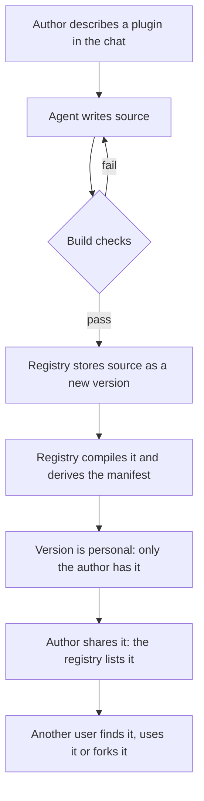
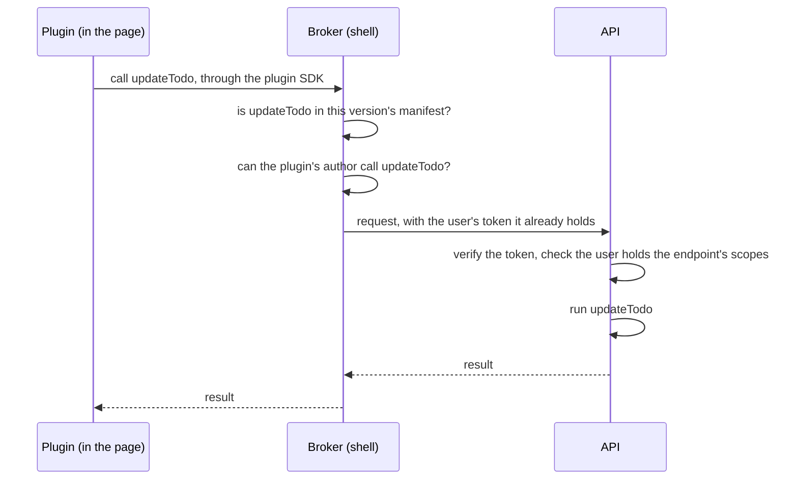
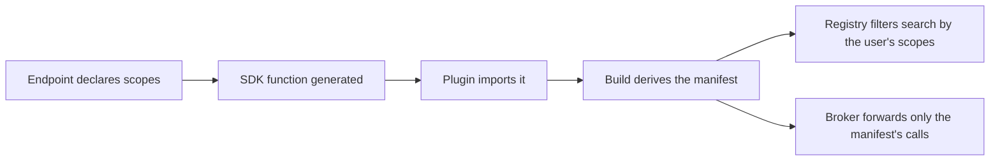

# Architecture

How the parts fit.

## The parts

| Part | Where it runs | What it does |
| --- | --- | --- |
| App API | Server | The implementor's endpoints. |
| Thixo API | Server | Thixo's side of the API, the same in every app. Issues tokens and enforces the user's scopes on every endpoint of both sides (A1, A4). |
| Plugin data | Server | The store and annotations, as fixed endpoints in Thixo's API. |
| Registry | Server | Stores versions, builds them, derives manifests, answers searches. |
| Plugin route | Server | Serves a plugin version's compiled JavaScript, and the files its build copied. |
| Authoring agent | Server | Writes plugins from a chat. Uses the registry's build and search. |
| Shell | Browser | The base app. Places slots, loads plugins, runs the broker. |
| Plugin | Browser, in the app's page | Renders into its slot while it is on screen. Calls the SDK. |

Thixo owns all of these except the endpoint handlers and the shell's own content.

## What the implementor writes

Following Next.js, Thixo reads an app from its folders:

```
api/        endpoints, each with its scopes
app/        the shell: the always-on app and its slots
plugins/    the default plugins, one folder each (G3)
thixo.config.ts
```

From `api/`, Thixo generates the API SDK and the plugin SDK. From `app/`, it knows the slots. From `plugins/`, it
builds the default plugins through the same pipeline a user's plugin goes through. Promoting a plugin to default
opens a change in `plugins/` through the code storage adapter. Only a deploy publishes: it stores a new version for
each folder whose source changed and records the default layout as a release (G3). The steps are in the
[data model](06-data-model.md#default-plugins-and-deploys).

## From source to a running plugin



The build checks and what the manifest holds are in the [security model](04-security-model.md#at-build). The checks
are the same whether the source came from the agent or the implementor's `plugins/` folder (P6, U4).

## What happens on a call

A plugin calls `updateTodo(...)`. The plugin holds no token and can't reach the network (P5, L4).



Two checks happen:

1. **The broker** refuses an endpoint that isn't in the version's manifest, or whose scopes the plugin's author
   doesn't hold (P1, P3). This is where a plugin is held to what it was built with.
2. **The API** verifies the user's token and checks that the user holds the endpoint's scopes (A4). Only then does
   it run the endpoint.

The API doesn't see which plugin is calling. A broker that forwards a call it should have refused gets anything the
user can do. That is accepted, because the shell already holds the user's session. What the design trusts, and why,
is in the [security model](04-security-model.md#what-is-trusted).

### Where the token comes from

1. The shell asks Thixo's API layer for a token, using the user's ordinary session.
2. Thixo asks the identity adapter to learn who the user is and which scopes they hold (A8).
3. Thixo signs a short-lived token naming the user.
4. The broker keeps it and attaches it to every plugin's calls. No plugin sees it (P5).

There is one token for the user, not one per plugin. When the shell loads a version, Thixo also tells the broker
which of that version's endpoints the plugin's author can call, so the broker can apply the author cap.

The manifest records endpoints, not scopes. Scopes are looked up from the endpoints when a call is checked, so a
change to an endpoint's scopes takes effect without rebuilding any plugin.

## Loading a plugin

1. The shell reads the user's layout to see which version fills each slot (S9).
2. For each filled slot, the shell loads that version's compiled JavaScript from the plugin route.
3. The shell hands the plugin its SDK, the slot's context, the design tokens and which of the plugin's endpoints
   the current user can call. The compiled code can reach nothing else (P5, P7).
4. The plugin renders into its slot, with its styles scoped to the slot (P8).
5. When the slot leaves the screen, the plugin stops. Nothing of it runs in the background (P7).

## The SDK

The SDK a plugin imports is a thin layer. Each function hands the call to the broker and waits for the reply.

- **One function per endpoint,** generated from the API definition (A9).
- **Two import paths.** `@app/sdk` for endpoints the plugin requires. `@app/sdk/optional` for endpoints it can work
  without (P2).
- **A plugin can ask about any endpoint it imports:** whether the current user may call it (P4).
- **Records come from the SDK too.** A plugin imports a record to annotate it, and gets its type.
- **Fixed modules for plugin data and shell services,** which are the same in every app.

The names `@app/sdk` and `thixo/...` are placeholders.

## Scopes, end to end



The scopes are written once, on the endpoint. Everything after that is derived (P2).

## Slots

The implementor defines each slot (S5). Thixo ships page, panel and widget as default slot types (S6).

- **Size:** the slot sets how big the plugin's space is and where it can appear.
- **Contract:** the context the shell passes in, such as which todo is selected, and the events a plugin can send
  back, such as "this todo was picked" (S10).
- **Context fields carry scopes:** each field of a slot's context names the scopes that read it, and a plugin that
  fills the slot requires them (S13). An author who can't read people can't fill a slot that hands out people data.
- **Child slots:** a slot's contract can declare slots inside it, such as a `todo-row` slot in each row of the
  list. The plugin filling the parent places them. Only the implementor defines slots (S13).

The app defines each slot once. The shell places it, and a plugin targets it, by importing that definition. A slot
is filled by one plugin (S12), and the user's layout says which. The shell routes the events a plugin sends (S11).

## Storing plugin data

Plugin data goes through the data adapter (X4). Its interface is in plugin-data terms, so each adapter decides how
to store it:

- Read a record's fields for a plugin, through its fork chain (D10).
- Read many records at once.
- Patch a record's fields (D6).
- Delete a field's data (D7).

The types those operations use, such as records, plugins and fields, are in the [data model](06-data-model.md).

A plugin never changes the database schema. Each adapter decides how it stores plugin data, and owns its schema and
its migrations. For how this works in SQL, see the [`thixo-sql` package docs](../packages/thixo-sql/readme.md).

**Layouts** go through the same adapter ([data model](06-data-model.md#layouts)). The default layout lives in the implementor's project, beside the default
plugins, and each deploy resolves it to versions as a release (S9, G3). A user's layout stores only what they changed: a slot and the plugin version that fills it. The
shell reads the user's changes over the default, the way a fork reads over its parent.
