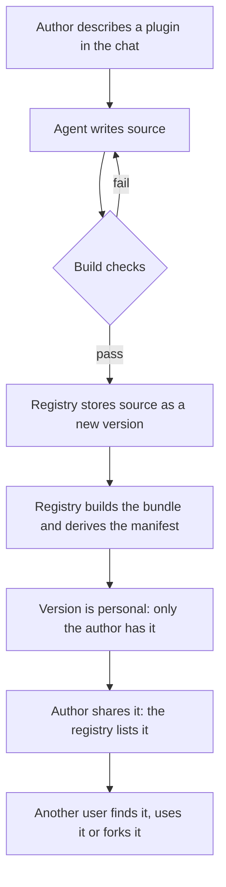
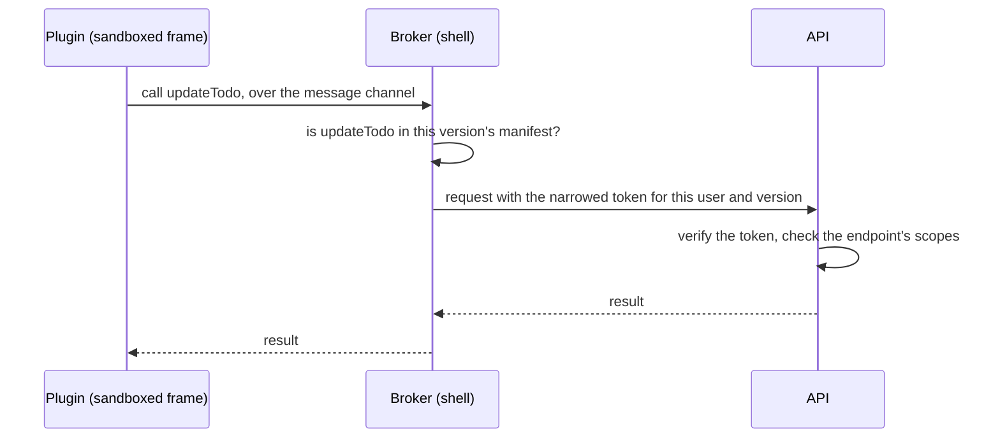
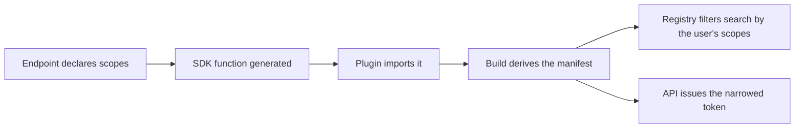

# Architecture

How the parts fit. Most of this follows from requirements marked Proposed, so it is a design to test, not a settled
one. Where a section depends on a requirement, it says which.

## The parts

| Part | Where it runs | What it does |
| --- | --- | --- |
| API | Server | The implementor's endpoints. Issues tokens and enforces scopes. |
| Plugin data | Server | The store and annotations, as fixed endpoints in the API. |
| Registry | Server | Stores versions, builds them, derives manifests, answers searches. |
| Plugin route | Server | Serves a built plugin with the headers that isolate it. |
| Authoring agent | Server | Writes plugins from a chat. Uses the registry's build and search. |
| Shell | Browser | The base app. Places slots, loads plugins, runs the broker. |
| Plugin | Browser, in a sandboxed frame | Renders into its slot. Calls the SDK. |

Tailor owns all of these except the endpoint handlers and the shell's own content.

## What the implementor writes

Following Next.js, Tailor reads an app from its folders:

```
api/        endpoints, each with its scopes
app/        the shell: the always-on app and its slots
plugins/    the default plugins, one folder each
tailor.config.ts
```

From `api/`, Tailor generates the SDK. From `app/`, it knows the slots. From `plugins/`, it builds the default
plugins through the same pipeline a user's plugin goes through.

## From source to a running plugin



The build checks and what the manifest holds are in the [security model](04-security-model.md#at-build). The checks
are the same whether the source came from the agent, a person or the implementor's `plugins/` folder (U4, U8).

## What happens on a call

A plugin calls `updateTodo(...)`. The plugin holds no token and can't reach the network (P8, P11).



Two checks happen, and only the second is trusted:

1. **The broker** refuses an endpoint that isn't in the version's manifest. This gives a fast, clear error.
2. **The API** verifies the narrowed token. Its scopes are the user's scopes intersected with the scopes derived for
   that plugin version (P9). Even a broken broker can't widen what a plugin does.

## Loading a plugin

1. The shell reads the user's layout to see which version fills each slot (S10).
2. For each filled slot, the shell renders a sandboxed frame pointed at the plugin route.
3. The plugin route returns Tailor's host document and the built bundle, with headers that block network access and
   limit who can frame it.
4. The host document runs first. It removes the browser features a plugin must not have, opens a message channel to
   the shell and loads the bundle.
5. The shell sends the slot's context, the design tokens and the list of endpoints the current user can call.
6. The plugin renders. It reports its height back so the shell can size the frame.

## The SDK

The SDK a plugin imports is a thin stub. Each function sends a message to the broker and waits for the reply.

- **One function per endpoint,** generated from the API definition (A10).
- **Two import paths.** `@app/sdk` for endpoints the plugin requires. `@app/sdk/optional` for endpoints it can work
  without; each of those can be asked whether the current user may call it (P4, P5).
- **Fixed modules for plugin data and shell services,** which are the same in every app.

The names `@app/sdk` and `tailor/...` are placeholders.

## Scopes, end to end



The scopes are written once, on the endpoint. Everything after that is derived (P2).

## Slots

A slot has a kind and a contract.

- **Kind:** page, panel or widget (S6). The kind sets how the frame is sized and where it can appear.
- **Contract:** the context the shell passes in, such as which todo is selected.

A plugin targets a slot by name. The shell can offer more than one plugin for the same slot, and the user's layout
picks among them.

## What is not designed yet

- How the build runs on each provider. See [portability](06-portability.md#build).
- What happens to existing plugins when the API changes. See [open questions](08-open-questions.md#api-changes).
- How a plugin acts without rendering, such as a button the shell draws. See
  [open questions](08-open-questions.md#slot-kinds).
