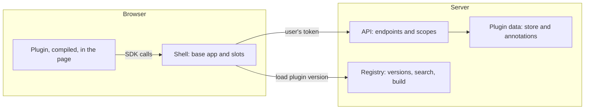

# Thixo


Thixotropic: holds its shape at rest, flows when you work it.

Thixo is a framework for building malleable SaaS products: apps whose own users can change them.

It is the flexibly opinionated framework. It ships a working answer for every part, and an implementor can swap any
of them for their own through an adapter. What an implementor changes is an adapter. What a user changes is a plugin.

A developer uses Thixo the way they would use Next.js. They define an API and a base app. Thixo adds the part that
is hard to build yourself: a safe way for the people using the app to write, share and run their own plugins inside
it.

> **Status: requirements.** There is no framework code yet. This repo holds the intent, the decisions made so far and
> the questions still open, so they can be argued with before any code is accepted. Start with
> [the requirements](docs/02-requirements.md).

## Why

Ink & Switch's essay [Malleable software](https://www.inkandswitch.com/essay/malleable-software/) describes tools
that "users can reshape with minimal friction to suit their unique needs," and argues that most software today is the
opposite: built far away, sealed and unchangeable.

Coding agents have made the reshaping cheap. A person can now describe a change and get working code. What is still
missing is a place to put that code:

- **A team needs common ground.** When everyone builds their own tools, the same tool gets built three times and none
  of them can be handed to a colleague.
- **Generated code can't be trusted with a user's full access.** A plugin written by an agent, or by a stranger,
  should be able to do only what it says it does.
- **Data has to survive the changes.** A plugin that adds a field today and is forked tomorrow must not lose what
  people have already written.

Thixo's position is that these are framework problems. A developer building a malleable product should get them
solved by default, and should not be able to get them wrong.

## The four parts

1. **An API with scopes.** The developer defines endpoints. Each endpoint carries the scopes a caller needs. The API
   issues tokens and enforces them.
2. **A base app with slots.** A React shell provides the always-on functionality, defines where plugins go and ships
   the default plugins.
3. **A place to write plugins.** A chat interface where a user describes what they want and an agent writes the
   plugin, plus storage that keeps every version.
4. **A registry.** Search that knows what each plugin needs and what each user is allowed to do, so people find and
   fork each other's plugins before building their own.



## What it looks like

An endpoint says what it needs:

```ts
export const updateTodo = endpoint({
  method: "PATCH",
  path: "/todos/:id",
  scopes: ["todos.read", "todos.write"],
  // ...
});
```

A plugin imports the endpoints it uses. Nothing else declares its permissions; the build reads them from the imports:

```tsx
import { listTodos, updateTodo } from "@app/sdk";
import { deleteTodo } from "@app/sdk/optional";
```

The shell says where plugins go:

```tsx
<Shell>
  <Nav />
  <Slot is={main} />
</Shell>
```

The full sketch is in [examples/todo](examples/todo). It does not run yet. It is the target the requirements are
written toward.

## Principles

- **Malleable, not constrained.** A plugin can render anything inside its slot. Thixo fixes the edges (the slot, the
  API, the data rules) and leaves the middle open.
- **The code is the source of truth.** A plugin's scopes come from the endpoints it imports, and its data schema from
  the types it declares. Nobody maintains a list by hand.
- **Going past your scopes is impossible, not discouraged.** A plugin never holds the user's session or token.
  The shell forwards from each plugin version only the calls it was built with.
- **Data outlives code.** Plugin versions come and go. No version can destroy what another one wrote.
- **No cloud lock-in.** Where code and data are stored, and where the server runs, are adapters. The first proof of
  concept targets Cloudflare. Vercel and AWS must work too.

## Reading order

| Doc | What it answers |
| --- | --- |
| [Concepts](docs/01-concepts.md) | What the words mean |
| [Requirements](docs/02-requirements.md) | What Thixo must do |
| [Architecture](docs/03-architecture.md) | How the parts fit and what happens on a call |
| [Security model](docs/04-security-model.md) | How a plugin is contained, and the known gaps |
| [The language](docs/05-language.md) | The language plugins are written in, and what its compiled code has to get right |
| [Data model](docs/06-data-model.md) | What Thixo stores, and the rules that keep plugin data safe |
| [Portability](docs/07-portability.md) | The adapters, and what each cloud has to provide |
| [Decisions](docs/08-decisions.md) | What was decided, when and why |
| [Open questions](docs/09-open-questions.md) | What is not decided |

## Layout

```
docs/          the requirements and design, in reading order
examples/      apps built with Thixo; today, one sketch
packages/      the framework's packages; today, a plan
```
